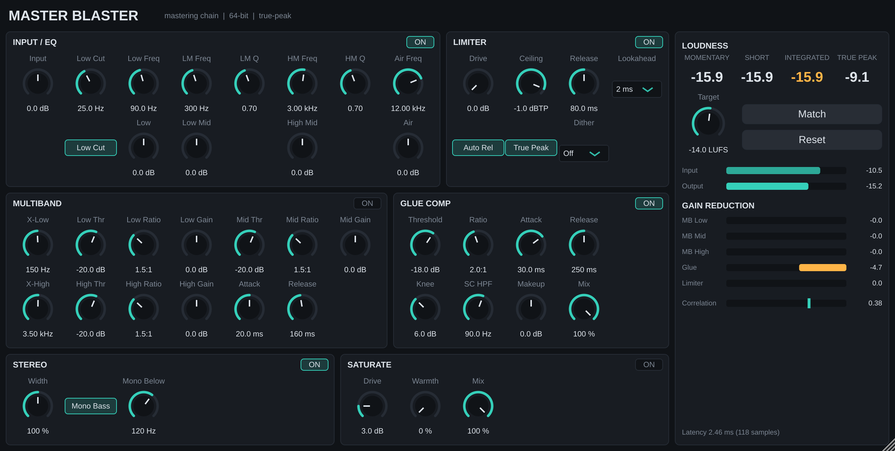

# Master Blaster

A one-stop **mastering chain** for your master bus: VST3 and AU (plus a standalone app). It runs in 64-bit floating point, its true-peak limiter does not overshoot its ceiling, and the latency is about **2.5 ms** with default settings.



## Signal chain

```
Input → EQ → Stereo → Multiband comp → Glue comp → Saturate (4x OS) → True-peak limiter → Dither
```

| Stage | What it does | Technique |
|---|---|---|
| **Input / EQ** | input trim, 24 dB/oct low cut, low shelf, two bells, "Air" high shelf | Cytomic trapezoidal SVF, smoothed so automation is click-free |
| **Stereo** | width (M/S), mono bass below a chosen frequency | LR4 high-pass on the side channel, matching allpass on mid (phase-coherent) |
| **Multiband** | 3-band compressor/leveller with per-band gain | LR4 crossovers that sum flat (zero latency), log-domain compressors |
| **Glue Comp** | stereo-linked bus compressor with sidechain HPF and parallel mix | Giannoulis/Reiss soft-knee feed-forward design |
| **Saturate** | tanh saturation with even-harmonic "Warmth" | 4x polyphase-IIR oversampling (>100 dB image rejection, a few samples of delay) |
| **Limiter** | brickwall limiter, ceiling in dBTP, auto release, lookahead 0.5–5 ms | 8x true-peak detection; hold plus cascaded-box gain smoothing (no overshoot) |
| **Dither** | 24-bit or 16-bit TPDF, optional noise shaping | the last stage in the chain |
| **Meters** | momentary, short-term and integrated LUFS, true-peak max, GR per stage, correlation | ITU-R BS.1770-4 / EBU R128 |

[`docs/RESEARCH.md`](docs/RESEARCH.md) explains the mastering practice and DSP research behind each choice.

## Quick workflow

1. Put Master Blaster last on your master bus.
2. Start with the defaults. EQ, stereo, glue and limiter are on with gentle settings; multiband and saturate are off.
3. Make broad EQ moves (±1–2 dB). Keep mono bass at 100–150 Hz.
4. Glue comp: aim for 1–3 dB of gain reduction on the loudest parts.
5. Set **Target** (−14 LUFS for streaming), play the loudest section for about 10 s, then press **Match**. The limiter drive moves to close the gap. Press it again to refine, because a limiter doesn't add loudness dB-for-dB.
6. Keep the ceiling at **−1 dBTP** for streaming/lossy formats. Turn dither on only when rendering to 16-bit, and only if your DAW isn't already dithering.

Every module's **ON** switch crossfades, so you can A/B while playing. With every module off, the plugin outputs a bit-exact, latency-compensated copy of its input.

## Building

You need CMake ≥ 3.22 and a C++17 compiler. JUCE 8.0.4 is fetched automatically.

```bash
cmake -S . -B build -DCMAKE_BUILD_TYPE=Release
cmake --build build --config Release --parallel
ctest --test-dir build -C Release      # DSP test suite
```

* **macOS (VST3 + AU, universal binary):** add `-DCMAKE_OSX_ARCHITECTURES="arm64;x86_64"`. The bundles land in `build/MasterBlaster_artefacts/Release/{VST3,AU}`. Copy them to `~/Library/Audio/Plug-Ins/VST3` and `~/Library/Audio/Plug-Ins/Components`.
* **Windows:** copy the `.vst3` to `C:\Program Files\Common Files\VST3`.
* **Linux:** copy the `.vst3` to `~/.vst3`.
* If you have a local JUCE checkout, pass `-DJUCE_DIR=/path/to/JUCE`.

**Prebuilt binaries:** the GitHub Actions workflow builds macOS (VST3 + AU, universal), Windows and Linux. It runs the tests, pluginval and `auval`, and uploads the bundles as workflow artifacts. The builds are unsigned. On macOS, after copying the plugins, run:

```bash
xattr -dr com.apple.quarantine ~/Library/Audio/Plug-Ins/Components/"Master Blaster.component" ~/Library/Audio/Plug-Ins/VST3/"Master Blaster.vst3"
```

## Tests

* `tests/dsp_tests.cpp` runs without JUCE. It checks:
  * half-band image rejection and oversampler passband flatness,
  * that the LR4 3-band sum is flat,
  * LUFS accuracy against BS.1770 reference signals at 44.1/48/96 kHz,
  * limiter ceiling compliance, checked independently with 16x interpolation,
  * that the limiter latency matches what the plugin reports,
  * that the bypassed chain is bit-exact,
  * full-chain CPU use.
* `tools/host_check` (`-DMB_BUILD_HOST_CHECK=ON`) loads the built VST3 the way a DAW does. It processes audio at several sample rates and irregular block sizes, round-trips the state, checks that the reported latency changes with the lookahead, and renders the UI.

## Layout

```
Source/dsp/        framework-free DSP (Filters, Oversampling, Dynamics, Loudness, MasterChain)
Source/            JUCE processor, parameters, editor
tests/             DSP test suite
tools/host_check/  VST3 host check and UI snapshot tools
docs/              research notes and screenshot
```
